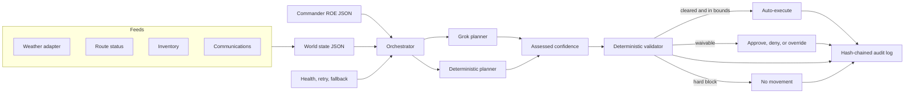

# Architecture

Assured Autonomy Ops Agent separates **proposal** from **permission**. A planner may suggest a resupply schedule. Only the deterministic validator can clear it, and only a commander can waive a hold. Nothing in the execute path trusts the model's confidence score.

The exercise, AO Copper, is fictional. Feeds other than an optional Open-Meteo weather stand-in are simulated. The three-minute scenario does not call the network.

## Diagram



## What runs where

| Piece | Module | Role |
| --- | --- | --- |
| Theater | `lib/theater.ts` | Nodes, routes, stock, demands, default ROE for Exercise Steadfast Haul |
| Deterministic planner | `lib/planner.ts` | Enumerates legal paths after dropping closed, no-go, and weather-abort legs |
| Grok adapter | `lib/grok.ts` | `POST {XAI_BASE_URL}/responses`, model from `XAI_MODEL`, `store: false`, two attempts |
| Orchestrator | `lib/orchestrator.ts` | Tries Grok, then the deterministic planner, then always validates |
| Validator | `lib/validator.ts` | Hard and waivable checks. Same function for every source |
| Confidence | `lib/confidence.ts` | Recomputes a score from coverage, risk margin, weather, and communications |
| Audit | `lib/audit.ts` | SHA-256 chain over canonical JSON. `tamperCopy` proves detection without editing the live log |
| Scenario | `lib/scenario.ts` | Pure reducer for the 180-second script and the monitor controls |
| Weather | `lib/weather.ts` and `app/api/weather` | Maps Open-Meteo or returns a labeled fallback |
| Health | `app/api/health` | Reports whether a key is configured. It does not call xAI and does not return the key |

The browser holds the exercise in a reducer. `POST /api/plan` is only used by **Ask Grok**. The client validates that response again, so a forged "cleared" flag in the HTTP body does not move a package.

## Plan contract

Any planner, including a third-party replacement for Grok, returns:

```json
{
  "id": "plan-example",
  "source": "grok",
  "reportedConfidence": 0.88,
  "confidence": 0.88,
  "rationale": "Why this schedule",
  "assumptions": ["What was assumed"],
  "movements": [
    {
      "id": "m-1",
      "convoyId": "alpha",
      "from": "davis",
      "to": "ridge",
      "routeId": "alt-ridge",
      "cargo": "I",
      "qty": 8,
      "departMinute": 24,
      "arriveMinute": 119
    }
  ]
}
```

Cargo is `I`, `III`, `V`, or `IX`. The orchestrator overwrites `source` and replaces `confidence` with the assessed score. `reportedConfidence` is kept so the console can show when the model is sure and the assessment is not.

## Validator disposition

| Disposition | Meaning | Approve | Override |
| --- | --- | --- | --- |
| `cleared` | Every check passed | Yes | No |
| `waivable` | No hard failure. At least one hold | No | Yes, with a justification of at least 20 characters |
| `blocked` | At least one hard failure | No | No |

Hard checks: unknown geometry, no-go route, closed route, package capacity, inventory reserve, class V on a civilian road, weather abort, risk more than 12 points over the ceiling, movement into a lost-communications node when policy is `hold` or `fallback-planner-only`.

Waivable checks: weather advisory, risk modestly over the ceiling, degraded communications, assessed confidence under the auto-execute floor, missed demand or late arrival.

`autoExecute` is true only when the disposition is `cleared` and autonomy is `execute-within-bounds`. `propose-only` always waits for Approve.

## Audit record

Each event stores `index`, `ts`, `type`, `actor`, `summary`, `payload`, `prevHash`, and `hash`.

```text
hash = SHA-256(previousHash + "|" + canonicalJson(body))
```

The genesis previous hash is 64 zeroes. Canonical JSON sorts object keys and preserves array order. Verification recomputes every hash. A copy with one summary changed fails at that index. The live log is not modified by the tamper demo.

## Self-healing

`withRetries` runs the model call twice. Timeouts, HTTP errors, and unparseable JSON all count as failures. The orchestrator then calls `deterministicPlan` and records `fallbackReason`. The scenario simulates that sequence without contacting xAI, so a live pitch does not depend on the API.

Health states shown on the strip: planner standby, retrying, or down; then deterministic and up. Communications roll up to the worst node. The audit badge flips if verification fails.

## Scenario beats

| Time | Beat | What changes |
| --- | --- | --- |
| 0:00 | Brief | Approved baseline is already on the chain |
| 0:14 | Nominal | Feeds green. Class I on MSR North, Class III on MSR Coast |
| 0:32 | Disruption | MSR North closes, weather advisory, Ridge communications degrade. Baseline invalidated |
| 0:50 | Detect | Packages hold. Replan starts |
| 1:06 | Unsafe plan | Corridor Red shortcut, reported confidence 0.91 |
| 1:26 | Blocked | No-go and hard risk ceiling. Override refused |
| 1:44 | Fallback | Two timeouts, deterministic planner engaged |
| 2:04 | Alternate | Alt Ridge plus Spur North. Weather, communications, and confidence are waivable |
| 2:22 | Decision | Commander window. Auto-decide fires 10 seconds later if nobody taps |
| 2:44 | Executing | Override is on the chain. The shortcut stays rejected |
| 2:56 | Verified | Chain recomputed |
| 3:00 | End | Playback stops |

## MOSA boundary

A third party can replace the planner by implementing `propose(world, roe) -> plan` and leaving `validate`, the ROE document, and the audit format alone. They do not need this codebase's engineers to sit in the integration if they honor those JSON shapes. The prototype is MIT licensed. A production data-rights package would still be negotiated; the license on this repo is the company's current posture for the prototype, not a government contract clause.

## Trade that the design refuses to blur

Plan quality, assurance, and availability pull against each other. Letting the model call a tool that dispatches a truck maximizes flexibility and fails closed-loop assurance. A planner with no model maximizes predictability and gives up the model's ability to explain a novel disruption. This build puts quality in the proposer, permission in the validator, and availability in the fallback. The model can be confident and wrong. The shortcut in the scenario is that case.
